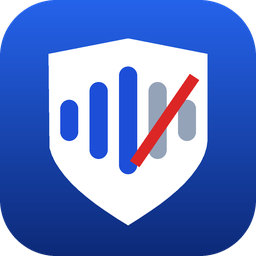

# desk-echo-guard

Windows 用的全系統回聲消除程式，給用**桌上型喇叭 + 桌上型麥克風**（不戴耳機）講 Discord / LINE 通話的人。

- **回聲消除**：對方不會再從你的麥克風聽到自己的回音。程式擷取喇叭正在播的聲音當參考，用 WebRTC AEC3 從麥克風訊號裡扣掉，再透過 VB-Cable 當成虛擬麥克風給通話軟體用。
- **Hey Siri 防誤觸**（選用）：對方說「Hey Siri」時，比較不會叫醒你的 HomePod / iPhone。做法仿照 Apple 在 WWDC 2026 被觀察到的手法：只削掉幾段 Siri 在意的頻帶，不是靜音。
- **Windows 11 風格介面**：設定改了就自動儲存、自動套用，滑鼠停在任何選項上都有說明。

> **使用前請知道**
> - v0.4.0 起是用 Rust 全新改寫的版本：功能和設定檔都跟舊版一樣，但更省記憶體與 CPU、單一 exe 秒開。它通過了所有自動測試與 Windows 自我檢測，但還沒在實機上長時間使用過；遇到問題可以先改用 [v0.3.1](https://github.com/samfeng0517/desk-echo-guard/releases/tag/v0.3.1)（Python 版，設定檔共用，可以直接換回去）並開 issue 回報。
> - 舊版（Python，v0.3.1）已在 Windows 實機（桌上型喇叭 + 桌上型麥克風，Discord 通話）上使用，回聲消除有效；新版用的是同一套 WebRTC 回聲消除。
> - Hey Siri 防誤觸預設用 `deep-wide`（2.8–6.5 kHz 整段深陷波）；舊版較淺的 `apple` 實機擋不住，已移除。Apple 的做法沒有官方公開，詳見 [Hey Siri 防誤觸](docs/siri-guard.md)。
> - v0.4.1：Hey Siri 防誤觸移除了需要自己訓練模型的 `detect`（偵測到「Hey Siri」才處理）模式，舊設定檔會自動改用 `sibilant`；`sibilant`（只在「s」音時處理）的延遲從約 1 秒降到約 0.07 秒。

## 下載

- 到 [Releases](https://github.com/samfeng0517/desk-echo-guard/releases) 下載最新的 `DeskEchoGuard.exe`。不用安裝，雙擊就能開。
- 另外需要免費的 [VB-Cable](https://vb-audio.com/Cable/)（虛擬音效線），要自己安裝。

## 快速開始

第一次使用、或要教朋友設定，請看圖文版的 **[5 分鐘上手](docs/getting-started.md)**；遇到問題看 **[常見問題](docs/faq.md)**。

1. **安裝 VB-Cable**：從 <https://vb-audio.com/Cable/> 安裝後重新開機（[詳細步驟](docs/getting-started.md#步驟-1安裝-vb-cable)）。
2. **打開 `DeskEchoGuard.exe`**。
   - Windows 若顯示「已保護您的電腦」，按「其他資訊 → 仍要執行」。
   - 麥克風和喇叭預設用 Windows 的預設裝置，VB-Cable 會自動找到。
   - 建議在「裝置」頁按「整理 VB-Cable…」，把名稱改成好懂的（[說明](docs/faq.md#vb-cable-改名後叫什麼)）。
3. **在首頁按「開始」**。
4. **設定通話軟體**（[詳細步驟](docs/getting-started.md#步驟-5設定-discord)）：
   - 麥克風改選 **`回聲消除麥克風`**（沒改名的話是 **`CABLE Output`**）。
   - 關掉通話軟體自己的回音消除。噪音抑制可以開（Discord 建議選 Krisp，可以去除鍵盤聲）。
   - 關掉 NVIDIA Broadcast。
5. 之後每次都**先開程式再開通話**，或在「進階」頁打開「登入 Windows 時自動啟動」。

## 文件

| 文件 | 給誰看 | 內容 |
|---|---|---|
| [5 分鐘上手](docs/getting-started.md) | 所有人 | 一步一步設定 VB-Cable、Discord、LINE，怎麼確認有效、每天怎麼用 |
| [常見問題](docs/faq.md) | 遇到問題時 | 對方還是聽到回音、聲音斷斷續續、聽不到我、移除… 依症狀找解法 |
| [Hey Siri 防誤觸](docs/siri-guard.md) | 家裡有 HomePod / iPhone 的人 | 要不要開、怎麼設定、選哪個強度 |
| [進階使用](docs/usage.md) | 想自己調的人 | 各頁面、命令列、設定檔、調校 |
| [運作原理](docs/how-it-works.md) | 好奇的人 | 接線圖、時脈漂移補償、引擎比較、延遲、程式碼結構 |
| [驗證結果與限制](docs/verification.md) | 好奇的人 | 量測數據、實機使用結果、已知限制 |
| [Hey Siri 研究與實測](docs/siri-guard-research.md) | 好奇的人 | Apple 和其他公司的做法、實測數據 |
| [開發說明](docs/development.md) | 開發者 | 編譯、測試、CI、發佈版本 |
| [設計與移植規格](DESIGN.md)、[介面規格](crates/app/UI.md) | 開發者 | crate 架構、API、GUI 規格 |

## 從原始碼建置（開發者）

需要 Rust 1.92 以上（[rustup](https://rustup.rs/)）。

```bash
cargo build --release -p desk-echo-guard   # 產出 target/release/DeskEchoGuard.exe
cargo test --workspace --release
```

- **Windows**：需要 MSVC 工具鏈（Visual Studio Build Tools 的「使用 C++ 的桌面開發」）。
- **Linux**（只用來開發和跑測試，沒有 WASAPI 音效後端）：WebRTC 引擎用的 `libwebrtc` 預編譯檔需要 **clang 21**，編譯前先設定 `export CC=clang-21 CXX=clang++-21`。
- **Cargo features**（在 `echoguard-aec`）：
  - `webrtc`（預設開）：WebRTC AEC3 引擎，透過 LiveKit 的 `libwebrtc` crate。
  - `speex`（預設開）：SpeexDSP 引擎，內附 C 原始碼用 `cc` 編譯。
  - 例：只建 Speex 引擎 `cargo build -p echoguard-aec --no-default-features --features speex`。
- 自我檢測：`DeskEchoGuard.exe --self-test report.txt`，最後一行應是 `RESULT: PASS`。
- 細節見[開發說明](docs/development.md)；crate 結構、移植規則與 API 見 [DESIGN.md](DESIGN.md)。
- 舊的 Python 版原始碼已移除，要看請到 [v0.3.1 標籤](https://github.com/samfeng0517/desk-echo-guard/tree/v0.3.1)。

## 授權

本專案以 [MIT 授權](LICENSE)釋出。使用的第三方元件各自依原本的授權：

| 元件 | 用途 | 授權 |
|---|---|---|
| [Slint](https://slint.dev/) | 圖形介面 | [Slint Royalty-free Desktop, Mobile, and Web Applications License](https://github.com/slint-ui/slint/blob/master/LICENSES/LicenseRef-Slint-Royalty-free-2.0.md)。本程式介面以 Slint 製作（Made with [Slint](https://slint.dev/)），「進階 → 關於」中附有 Slint 標示。 |
| [WebRTC](https://webrtc.org/)（經由 LiveKit `libwebrtc`） | 回聲消除、降噪 | BSD 3-Clause（WebRTC）；LiveKit Rust SDK 為 Apache-2.0 |
| [SpeexDSP](https://www.speex.org/) | 回聲消除（Speex 引擎） | BSD 3-Clause（Xiph.Org） |
| [Fluent UI System Icons](https://github.com/microsoft/fluentui-system-icons) | 介面圖示 | MIT（[授權全文](crates/app/ui/icons/LICENSE-fluentui-system-icons.txt)） |

[VB-Cable](https://vb-audio.com/Cable/) 是 VB-Audio 的軟體（VB-CABLE 免費、VB-CABLE A+B 為捐款軟體），需要另外安裝，不包含在本專案內。
