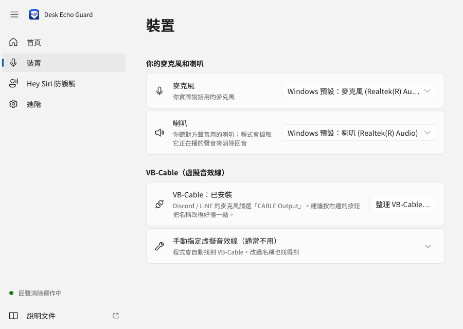
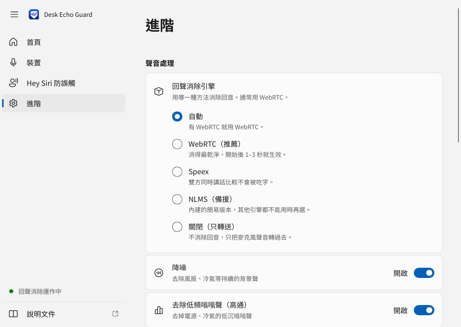

# 5 分鐘上手

[← 回 README](../README.md) ・ [常見問題](faq.md) ・ [Hey Siri 防誤觸](siri-guard.md)

照著做一次就好，之後每天只要「先開程式、再開通話」。

## 這個程式在做什麼

用**桌上型喇叭**（不是耳機）講 Discord / LINE 時，對方的聲音從你的喇叭播出來，又被你的麥克風收進去，傳回給對方。對方就會聽到自己晚一點點的聲音，這就是**回音**。

```
  對方說「喂？」
       │
       ▼
   你的喇叭 ──(聲音在房間裡傳)──► 你的麥克風
                                      │
                                      ▼
                           對方聽到自己的「喂？」= 回音
```

這個程式會：

- 聽你的喇叭正在播什麼。
- 從麥克風的聲音裡，把這一段「扣掉」。
- 只把你說的話送給對方。

所以你不用戴耳機，對方也不會聽到回音。

想知道背後怎麼做到的，見[運作原理](how-it-works.md)（給好奇的人看，不看也能用）。

## 你需要什麼

- 一台 **Windows 10 / 11** 電腦。
- 桌上型喇叭 + 麥克風（筆電內建的也可以）。
- **VB-Cable**：免費的「虛擬音效線」。可以想成一條看不見的線，把本程式處理好的聲音接給 Discord / LINE，讓它們把它當成一支麥克風。
- 第一次設定大約 5 分鐘，中間要**重新開機一次**。

## 步驟 1：安裝 VB-Cable

1. 用瀏覽器打開 <https://vb-audio.com/Cable/>。
2. 按 Windows 版的**下載**按鈕，會下載一個 zip 壓縮檔。
3. 到「下載」資料夾，在 zip 檔上按右鍵 → **解壓縮全部…** → **解壓縮**。
4. 在解壓出來的資料夾裡，對 **`VBCABLE_Setup_x64.exe`** 按右鍵 → **以系統管理員身分執行**。
5. Windows 問「要允許此 App 變更您的裝置嗎？」→ 按 **是**。
6. 按 **Install Driver**。
7. 裝好後按 **確定**。
8. **重新開機**。（不重開，程式會找不到它。）

> 要用 Hey Siri 防誤觸的人，還要多裝一條 VB-CABLE A+B，見 [Hey Siri 防誤觸](siri-guard.md)。不需要的話先跳過。

## 步驟 2：下載並打開程式

1. 到 [Releases 下載頁](https://github.com/samfeng0517/desk-echo-guard/releases) 下載最新版的 **`DeskEchoGuard.exe`**。
   - 如果下載到的是 zip，先解壓縮，裡面的檔案放在同一個資料夾，不要拆開。
2. 把它放在一個固定的資料夾，例如「文件」裡新增一個 `DeskEchoGuard` 資料夾。
   - 之後不要再搬它，開機自動啟動才找得到。
3. 雙擊 **`DeskEchoGuard.exe`**。
4. 如果出現藍色的「**Windows 已保護您的電腦**」：
   1. 按 **其他資訊**。
   2. 按 **仍要執行**。
   - 這是因為程式沒有付費買「數位簽章」，不是病毒。

打開後會看到**首頁**：


## 步驟 3：把 VB-Cable 改成好懂的名字（建議）

VB-Cable 的原始名稱很容易搞混（叫「Input」的其實是喇叭，叫「Output」的才是麥克風）。讓程式幫你改名：

1. 點左邊的 **裝置**。
2. 在 VB-Cable 那一張卡片按 **整理 VB-Cable…**。
3. 勾 **改成好懂的名稱**。
   - 另一個選項「停用用不到的 VB-Cable 裝置」也可以勾，Discord / LINE 的清單會比較乾淨。有在用 OBS 等其他軟體搭配 VB-Cable 的人不要勾。
4. 按確認。
5. Windows 問「要允許此 App 變更您的裝置嗎？」→ 按 **是**。

改好之後，Discord / LINE 裡會看到一支叫「**回聲消除麥克風**」的麥克風。

- 只改顯示的名稱，不影響驅動；改名前後程式都找得到裝置。
- 每個裝置改成什麼名字、怎麼改回來，見[常見問題：VB-Cable 改名後叫什麼](faq.md#vb-cable-改名後叫什麼)。



> 裝置頁的「麥克風」「喇叭」預設是 Windows 平常在用的那組，通常不用動。不確定的話，把滑鼠停在選單上，會跳出說明。

## 步驟 4：按「開始」

1. 點左邊的 **首頁**。
2. 按大大的 **開始** 按鈕。
3. 上面顯示「**回聲消除：運作中**」就對了。

## 步驟 5：設定 Discord

1. 打開 Discord，按左下角你名字旁邊的**齒輪**（**使用者設定**）。
2. 左邊點 **語音與視訊**。
3. **輸入裝置** 選 **回聲消除麥克風**。
   - 沒改名的話，選 **CABLE Output (VB-Audio Virtual Cable)**。
4. **輸出裝置** 選你的喇叭（不要選任何 CABLE 開頭或「勿選」的裝置）。
5. 往下找到語音處理的地方，把 **回音消除** 關掉。
   - 兩邊同時消回音會互相干擾，反而變差。
6. **噪音抑制** 可以留著，建議選 **Krisp**（可以去掉鍵盤聲）。
   - 它處理的是本程式**已經消除回音之後**的聲音，不會影響回聲消除。
7. **自動增益控制** 關掉。
8. **進階語音活動** 關掉。

> 小提醒：首頁有一張「在通話軟體這樣設定」卡片，會直接告訴你要選哪個名字，旁邊有 **複製** 按鈕。

## 步驟 6：設定 LINE 電腦版

1. 打開 LINE，進 **設定**。
2. 點 **通話**。
3. **麥克風** 選 **回聲消除麥克風**（沒改名的話選 **CABLE Output**）。
4. **喇叭** 選你的喇叭。

LINE 通常沒有「回音消除」的開關，不用管。對方覺得你的聲音忽大忽小的話，可以到程式的 **進階** 頁切換 **自動音量（AGC）** 比較看看。

## 步驟 7：關掉 NVIDIA Broadcast（有裝的話）

- 有裝 **NVIDIA Broadcast** 的話，把它的麥克風效果關掉，或直接結束它。
- 它的「降噪」會把麥克風聲音改得面目全非，程式就認不出回音，反而消不乾淨。
- 它的「Room Echo Removal」去的是房間的**殘響**，不是對方聲音的**回音**，解決不了這個問題。
- 想去鍵盤聲、背景聲，用 Discord 的 **Krisp** 就好。

## 怎麼確認有用

**一個人就能測：**

1. 確認首頁是「運作中」。
2. 用喇叭播一段 YouTube 影片（有人講話的）。
3. 看首頁的三條音量條：
   - **喇叭播放中**：會跳 → 正常，表示程式聽得到喇叭。
   - **你的麥克風**：也會跳一點 → 正常，麥克風收到了喇叭的聲音。
   - **送給對方**：**幾乎不動** → 回音被消掉了。
4. 這時你自己說話，「送給對方」應該會跟著跳。

**通話時：**

1. 請對方說話。
2. 看「**送給對方**」幾乎不動，就是成功。
3. 也可以直接問對方：「你有聽到自己的回音嗎？」
   - 剛開始的 1–3 秒還有一點點回音是正常的，程式需要一點時間「學習」你房間的聲音。

不行的話，看[常見問題](faq.md)。

## 調整麥克風音量（建議做一次）

麥克風音量太大、聲音「爆掉」時，回聲消除會暫時失效，而且要好一陣子才恢復。

1. **設定 → 系統 → 音效**，在「輸入」底下點你的麥克風。
2. 把 **輸入音量** 調到大約 **70–80%**。
3. 大聲說話時，首頁沒有出現「麥克風太大聲」的黃色警告就好。

## 每天怎麼用

- **先開程式，再開通話。** 程式沒在跑的時候，「回聲消除麥克風」是沒有聲音的，對方會聽不到你。
- **讓它開機自動啟動**（推薦，設定一次就不用管）：
  1. 點左邊的 **進階**。
  2. 打開 **登入 Windows 時自動啟動**。
  3. 之後每次登入 Windows，程式會自己在背景開始。
- **按視窗右上角的 X 不會關掉程式**，它會縮到右下角的**系統匣**（時鐘旁邊的小圖示區，可能要按 **^** 才看得到）繼續運作。
  - 雙擊圖示：叫回視窗。
  - 右鍵圖示：**開始 / 停止**，或 **結束**（真的關掉程式）。
- **設定改了就生效**，不用按儲存，也不用先停止。改完右下角會出現「已套用變更」。
- 任何按鈕、選項看不懂：**把滑鼠停在上面一下**，就會跳出說明。



## 下一步

- 遇到問題：[常見問題](faq.md)
- 想自己調整、用命令列：[進階使用](usage.md)
- 家裡有 HomePod / iPhone，怕對方說「Hey Siri」把它叫醒：[Hey Siri 防誤觸](siri-guard.md)
