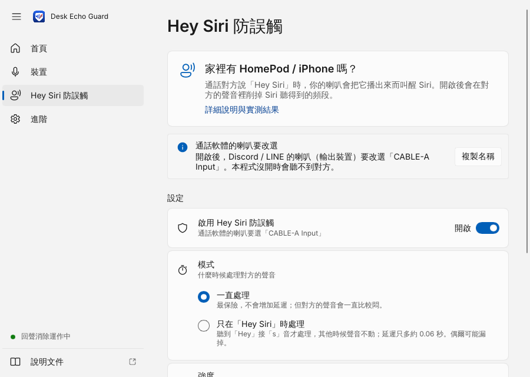

# Hey Siri 防誤觸

[← 回 README](../README.md) ・ [5 分鐘上手](getting-started.md) ・ [常見問題](faq.md)

## 我需要這個嗎？

只有**同時符合**下面兩點才需要：

- 你家裡有 **HomePod**，或 **iPhone / iPad** 開著「嘿 Siri」。
- 通話時，對方說「Hey Siri」，從你的喇叭播出來，**真的把你的 Siri 叫醒過**。

沒遇過這個問題 → **不用開**，跳過這一頁就好。

## 它怎麼做到的（一句話版）

- 對方的聲音先經過本程式，再從喇叭播出來。
- 程式把對方聲音裡 Siri 用來辨認的**中高音削掉**。人還是聽得懂，但 Siri 比較認不出來。
- 這是仿照 Apple 在 WWDC 2026 發表會被觀察到的做法（Apple 沒有正式公開）。

## 需要多裝什麼

除了原本的 VB-Cable，還要多裝**第二條虛擬音效線 VB-CABLE A+B**：

1. 打開 <https://vb-audio.com/Cable/>。
2. 在同一頁找到 **VB-CABLE A+B** 並下載。
   - 它是「捐款軟體」：可以先免費下載使用，覺得好用再捐款給作者。
3. 解壓縮 zip。
4. 對資料夾裡的 **`VBCABLE_Setup_x64.exe`** 按右鍵 → **以系統管理員身分執行** → **是**。
5. 按 **Install Driver**。
6. **重新開機。**

裝好之後再做一次改名，讓名字好懂：

1. 打開程式，點左邊的 **裝置**。
2. 按 **整理 VB-Cable…**，勾 **改成好懂的名稱**，按確認，Windows 問的時候按 **是**。
3. 改好後會多一個叫「**Siri防護喇叭**」的喇叭。

## 怎麼開

1. 點左邊的 **Hey Siri 防誤觸**。
2. 打開 **啟用**。
3. 到 Discord：**使用者設定 → 語音與視訊 → 輸出裝置** 選 **Siri防護喇叭**。
   - 沒改名的話選 **CABLE-A Input**。
   - LINE：**設定 → 通話 → 喇叭** 選 **Siri防護喇叭**。
4. 程式的 **裝置** 頁裡的 **喇叭** 保持選你**真正的喇叭**，不要動。
5. 關掉 Discord / LINE 再重開一次（剛改名的話才看得到新名字）。

這是唯一多出來的通話軟體設定：**輸出（喇叭）改選「Siri防護喇叭」**。麥克風一樣選「回聲消除麥克風」。

> **注意：** 開了之後，對方的聲音一定要經過本程式才播得出來。**程式沒在跑，你就聽不到對方。** 不想用了，記得把通話軟體的輸出改回你的喇叭。

## 要選哪個模式、哪個強度？

**模式（什麼時候處理對方的聲音）**

| 模式 | 什麼時候處理 | 優點 | 缺點 |
|---|---|---|---|
| **always**（一直處理，預設） | 一律處理 | 最保險；延遲只多 0.0125 秒 | 對方的聲音整通電話都比較悶 |
| **heysiri**（只在「Hey Siri」時處理，v0.4.6 新增） | 聽到「Hey」後面接「s」音才開始處理 | 平常的聲音完全不動，中文的「四、謝謝、是」幾乎不會被處理到 | 辨識模型是用合成語音訓練的，偶爾會漏掉（測試約 9 成辨識到）；延遲多約 0.07 秒 |
| **sibilant**（只在「s」音時處理） | 只要有「s」這類嘶聲，就處理接下來約半秒 | 不靠模型，不太會漏 | 中文裡有很多類似的音，對方的聲音常常被短暫削掉；延遲多約 0.07 秒 |

- **heysiri 怎麼運作：**
  1. 聽到「s」音的當下，檢查前面 0.4 秒像不像「Hey／嘿」。像，才開始處理。
  2. 0.12 秒和 0.25 秒後再各檢查一次：聽起來還像「Hey Si…」「Hey Sir…」就繼續處理到約半秒；不像（例如「Hey Sam」「黑色」）就馬上停止。
  3. 因為「Hey」在「s」音之前就講完了，不用多等，所以延遲和 sibilant 一樣。
- 用真人朗讀的中文測試：sibilant 模式有 2 成左右的時間在處理，heysiri 只有 1.4%。
- heysiri 只認「**Hey** Siri／**嘿** Siri」。在台灣 Siri 需要說「嘿 Siri」才會醒；如果你的裝置設成英文、而且開了只說「Siri」就能喚醒，請用 always 或 sibilant。
- 訓練用的「Hey Siri」都是英文語音念的；用中文腔調說的「嘿 Siri」沒有另外測過，可能比較容易漏。

**強度（削掉多少）**

| 強度 | 削掉的範圍 | 聽起來 | 什麼時候用 |
|---|---|---|---|
| **deep-wide**（標準，預設） | 1–6.5 kHz | 明顯變悶，像隔著一道門；聽得懂 | 先用這個 |
| **formant**（加強） | 0.5–8 kHz | 幾乎只剩低音，很難聽懂 | 標準擋不住時；只建議搭配 heysiri 或 sibilant 模式 |

- **v0.4.6 把「標準」加強了**：舊的「標準」只削 2.8–6.5 kHz，實機用「一直處理 + 標準」還是會被叫醒。新的「標準」連 1–3 kHz 一起削（也就是舊的「加強」再把高音整段削掉）。
- **「輕微」和「較淺」已移除**：它們比舊的「標準」還弱。設定檔裡的 `apple-deep`、`apple-wide` 會自動改用 `deep-wide`。
- **覺得「一直處理 + 標準」太悶？** 把模式改成 **heysiri**：只有「Hey Siri」那半秒會變悶，其他時間完全不變。
- 新的強度**還沒在 HomePod / iPhone 上實測過**，麻煩試了之後回報結果。

## 怎麼測試有沒有用

1. 開好防誤觸，按 **開始**。
2. 用另一台手機或電腦，透過 Discord / LINE 打給自己，或請朋友幫忙。
3. 請對方說幾次「Hey Siri」（或播一段有人說「Hey Siri」的影片）。
4. 看你的 HomePod / iPhone 有沒有被叫醒。

## 對方說話時，降低其他聲音的音量

看影片、聽音樂時聽不清楚朋友說話，可以打開這個功能（v0.4.6 新增，**預設關閉**）：

1. 先照上面的步驟開啟 Hey Siri 防誤觸（對方的聲音要經過本程式，程式才知道對方在說話）。
2. 在 **Hey Siri 防誤觸** 頁的最下面，打開 **降低其他聲音的音量**。
3. 用 **降低多少** 調整幅度：60% 表示降到原本的四成，100% 是完全靜音。

- 對方一開口，其他程式（瀏覽器、音樂、遊戲…）的音量會在約 0.1 秒內降下來；對方停止說話約 1 秒後恢復。
- 做法是調整 Windows「音量混音器」裡其他程式的音量，對方的聲音不會被動到。
- 程式停止或關閉時會恢復原本的音量。萬一程式被強制結束而音量沒恢復，下次（這個功能開著時）按「開始」會自動恢復；也可以自己到 Windows 的音量混音器調回來。
- 這個功能是照 Windows 的文件寫的，**還沒在實機上測過**，有問題請回報。
- 不想繞這一圈的話，Discord 自己也有類似的功能：**使用者設定 → 語音與視訊 → 衰減**。

## 老實說的限制

- **沒辦法保證 100% 擋住。** Apple 自己在發表會用類似方法，還是有觀眾的裝置被叫醒。
- 作者實測：舊版只削高音的設定（30 dB 的窄頻、以及 v0.4.5 以前的「標準」2.8–6.5 kHz）都擋不住。v0.4.6 的新「標準」還沒在 HomePod / iPhone 上實測過。
- 用開源的語音偵測器測試時，要削到 3 kHz 以下才有效，這也是新「標準」的依據。Siri 的偵測器是否一樣，沒有人知道。
- **heysiri** 模式的辨識模型只用合成語音訓練過（找不到公開的真人「Hey Siri」錄音），真人的聲音可能辨識得比較差。漏掉的那一次就不會被處理。
- **heysiri** 和 **sibilant** 都是從「s」音開始削；如果 Siri 在「Hey」的時候就已經認出來，這兩個模式擋不到。
- 開了之後，對方聲音要多繞一圈經過本程式；程式沒開就聽不到對方。
- **最保險的做法**仍然是：通話時把 HomePod / iPhone 的「嘿 Siri」關掉，或把它放遠一點。另外，iPhone 的 Siri 本來就會比對「是不是主人的聲音」，所以別人說「Hey Siri」不一定每次都叫得醒。

## 想知道更多

詳細研究、Apple 和其他公司的做法、實測數據：[Hey Siri 防誤觸（研究與實測）](siri-guard-research.md)。
