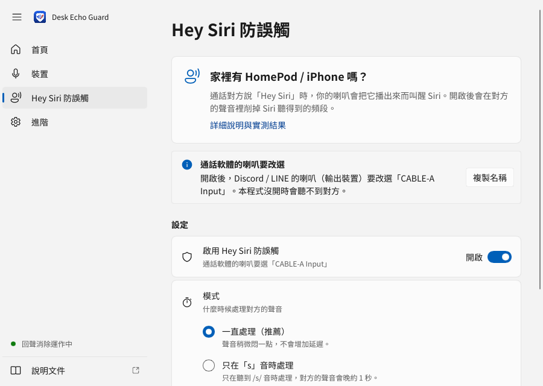

# Hey Siri 防誤觸

[← 回 README](../README.md) ・ [5 分鐘上手](getting-started.md) ・ [常見問題](faq.md)

## 我需要這個嗎？

只有**同時符合**下面兩點才需要：

- 你家裡有 **HomePod**，或 **iPhone / iPad** 開著「嘿 Siri」。
- 通話時，對方說「Hey Siri」，從你的喇叭播出來，**真的把你的 Siri 叫醒過**。

沒遇過這個問題 → **不用開**，跳過這一頁就好。

## 它怎麼做到的（一句話版）

- 對方的聲音先經過本程式，再從喇叭播出來。
- 程式把對方聲音裡 Siri 最在意的幾段**高音削掉**。人還是聽得懂，但 Siri 比較認不出來。
- 這是仿照 Apple 在 WWDC 2026 發表會被觀察到的做法（Apple 沒有正式公開）。

## 需要多裝什麼

除了原本的 VB-Cable，還要多裝**第二條虛擬音效線 VB-CABLE A+B**：

1. 打開 <https://vb-audio.com/Cable/>。
2. 在同一頁找到 **VB-CABLE A+B** 並下載。
   - 它是「捐款軟體」：可以先免費下載使用，覺得好用再捐款給作者。
3. 解壓縮 zip。
4. 對資料夾裡的 **`VBCABLE_Setup_x64.exe`** 按右鍵 → **以系統管理員身分執行** → **是**。
5. 按 **Install Driver**。
6. **重新開機。**

裝好之後再做一次改名，讓名字好懂：

1. 打開程式，點左邊的 **裝置**。
2. 按 **整理 VB-Cable…**，勾 **改成好懂的名稱**，按確認，Windows 問的時候按 **是**。
3. 改好後會多一個叫「**Siri防護喇叭**」的喇叭。

## 怎麼開

1. 點左邊的 **Hey Siri 防誤觸**。
2. 打開 **啟用**。
3. 到 Discord：**使用者設定 → 語音與視訊 → 輸出裝置** 選 **Siri防護喇叭**。
   - 沒改名的話選 **CABLE-A Input**。
   - LINE：**設定 → 通話 → 喇叭** 選 **Siri防護喇叭**。
4. 程式的 **裝置** 頁裡的 **喇叭** 保持選你**真正的喇叭**，不要動。
5. 關掉 Discord / LINE 再重開一次（剛改名的話才看得到新名字）。

這是唯一多出來的通話軟體設定：**輸出（喇叭）改選「Siri防護喇叭」**。麥克風一樣選「回聲消除麥克風」。

> **注意：** 開了之後，對方的聲音一定要經過本程式才播得出來。**程式沒在跑，你就聽不到對方。** 不想用了，記得把通話軟體的輸出改回你的喇叭。

## 要選哪個模式、哪個強度？

**先用預設就好：**

| 項目 | 選這個 | 說明 |
|---|---|---|
| 模式 | **always**（一律處理） | 對方的聲音一直都處理。不會多出明顯的延遲。 |
| 強度 | **deep-wide** | 聲音會稍微暗一點點，大多數人聽不太出來。 |

**還是會被叫醒的話：**

| 強度 | 聽起來 | 什麼時候用 |
|---|---|---|
| **deep-wide**（預設） | 稍微變暗 | 先用這個 |
| **apple-deep** | 幾乎聽不出來 | 想要聲音最自然，可以接受比較擋不住 |
| **apple-wide** | 稍微變暗 | 和 deep-wide 差不多，削得比較淺 |
| **formant** | 明顯變悶，但聽得懂 | deep-wide 擋不住時改用這個，最有效 |

**其他兩個模式（一般人不用）：**

- **sibilant**：只有聽到「斯」這類的音才處理。缺點是對方的聲音會**晚大約 1 秒**才聽到，聊天時會覺得卡卡的；其他有「斯」音的字也會被處理到。
- **detect**：只有偵測到「Hey Siri」那一句才處理。要自己準備一個「喚醒詞模型檔」（要自己訓練，作者也還沒做過），對方聲音同樣會晚大約 1 秒。

> 小技巧：用 **formant** 擋得住、但整通電話都變悶很困擾的話，可以研究 **detect** 模式，只讓「Hey Siri」那一秒變悶。這需要一些技術能力，見[訓練說明](../../tools/train_hey_siri/README.md)。

## 怎麼測試有沒有用

1. 開好防誤觸，按 **開始**。
2. 用另一台手機或電腦，透過 Discord / LINE 打給自己，或請朋友幫忙。
3. 請對方說幾次「Hey Siri」（或播一段有人說「Hey Siri」的影片）。
4. 看你的 HomePod / iPhone 有沒有被叫醒。

## 老實說的限制

- **沒辦法保證 100% 擋住。** Apple 自己在發表會用類似方法，還是有觀眾的裝置被叫醒。
- 作者實測：舊版比較淺的設定擋不住；目前預設的 **deep-wide** 還沒在 HomePod / iPhone 上正式實測過。
- 用開源的語音偵測器測試時，只有 **formant** 明顯有效，其他強度幾乎擋不住。Siri 的偵測器是否一樣，沒有人知道。
- **detect** 模式需要的模型，作者沒有實際訓練、測試過。
- 開了之後，對方聲音要多繞一圈經過本程式；程式沒開就聽不到對方。
- **最保險的做法**仍然是：通話時把 HomePod / iPhone 的「嘿 Siri」關掉，或把它放遠一點。另外，iPhone 的 Siri 本來就會比對「是不是主人的聲音」，所以別人說「Hey Siri」不一定每次都叫得醒。

## 想知道更多

詳細研究、Apple 和其他公司的做法、實測數據：[Hey Siri 防誤觸（研究與實測）](../../docs/siri-guard.md)。
