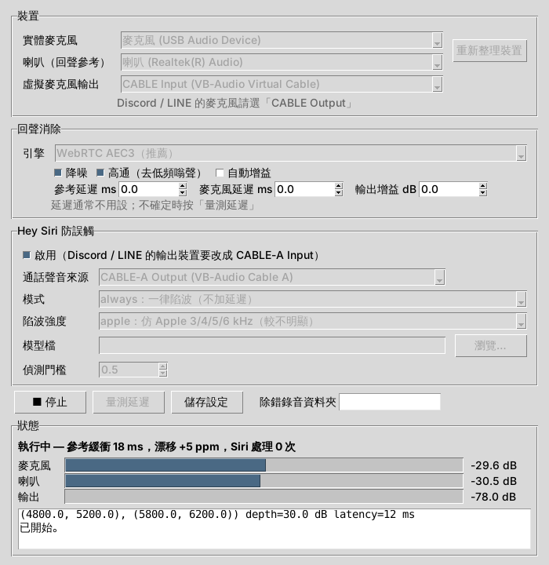

# 使用說明與調校

[← 回 README](../README.md)

## 圖形介面

雙擊 `DeskEchoGuard.exe`（或原始碼裡的 `start_gui.bat`）會開設定視窗。



1. 選裝置：
   - 實體麥克風、喇叭（回聲參考）：預設用 Windows 的預設裝置，通常不用改。
   - 虛擬音效線：自動找到 VB-Cable，這一行會告訴你 Discord / LINE 的麥克風要選哪個。建議按「改成好懂的名稱…」，見[讓 VB-Cable 的名稱好懂一點](setup.md#讓-vb-cable-的名稱好懂一點建議)。
   - 想自己指定 VB-Cable 裝置（例如裝了其他虛擬音效線），勾「顯示進階裝置選項」。
2. 選回聲消除引擎，通常用 WebRTC。三種引擎的差別見[引擎比較](how-it-works.md#引擎比較)。
3. 要防 Hey Siri 誤觸的話勾「啟用」，並選模式和陷波強度，見 [Hey Siri 防誤觸](siri-guard.md#怎麼選)。
4. 按「▶ 開始」。

**狀態區**

- 即時顯示麥克風、喇叭、輸出三條音量條，以及參考緩衝和時脈漂移。
- 麥克風太大聲時會提醒。

**量測延遲**

- 按下後會播約 4 秒雜訊，告訴你要不要調延遲。
- 通常不用調，見[調校](#調校)。

**設定檔**

- 按「開始」或關閉視窗時，設定會自動存到 `%APPDATA%\desk-echo-guard\echoguard.toml`，下次開啟沿用。
- 命令列的 `--config` 也讀得懂這個檔案。

**關閉視窗＝縮到背景**

- 按視窗的 X 不會結束程式，而是縮到右下角系統匣（通知區）繼續執行，回聲消除不會中斷。
- 雙擊系統匣圖示可以叫回視窗；按右鍵可以「▶ 開始 / ■ 停止」或「結束」。
- 要真正結束程式，請在系統匣圖示按右鍵 →「結束」。

**開機自動啟動**

- 勾選視窗下方的「登入 Windows 時自動開啟並開始」。
- 之後每次登入 Windows，程式會直接在系統匣啟動，並用**已儲存的設定**自動開始，不會跳出視窗。
- 登入後音效裝置（VB-Cable）可能晚幾秒才出現，程式會每 5 秒重試，最多約 1 分鐘；還是失敗才會跳出視窗提醒。
- 取消勾選即可關閉。這個設定寫在 `HKCU\Software\Microsoft\Windows\CurrentVersion\Run` 的 `DeskEchoGuard`。
- exe 換位置或更新後，只要開一次新的 exe，開機項目就會自動改指向新的位置。

**高解析度（4K）螢幕**

- 視窗會依 Windows 的「縮放比例」放大文字、間距和圖示，在 150%、200% 等設定下不再顯得很小或模糊。
- 如果你把視窗拖到縮放比例不同的另一個螢幕，它會維持啟動時那個螢幕的大小；重開程式即可。

**修改設定**

- 執行中所有設定欄位都會鎖住。
- 要改設定請先按「■ 停止」，改完再按「▶ 開始」。

## 命令列

命令列和圖形介面的功能一樣，只是改用參數設定。

```bat
python -m echoguard --list-devices
python -m echoguard --mic "USB" --speaker "Realtek" --out "CABLE Input"
python -m echoguard --mic "USB" --speaker "Realtek" --siri-guard --siri-mode always
python -m echoguard --config echoguard.toml
python -m echoguard --calibrate --mic "USB" --speaker "Realtek"
```

**裝置名稱**用「部分字串、不分大小寫」比對，例如 `--mic "USB"`。`--out "CABLE Input"`、`--call-in "CABLE-A Output"` 在 VB-Cable 改名後也找得到。

**狀態輸出**：每 5 秒印一行，包含：

- 麥克風、參考、輸出音量
- 緩衝水位、漂移 ppm、欠載次數（`ur=`）
- 每 10 ms 音框的運算時間

**設定檔**

- 從 [`echoguard.example.toml`](../echoguard.example.toml) 複製一份來改。
- 鍵名就是命令列長選項名稱，`-` 或 `_` 都可以。
- 命令列參數會覆蓋設定檔裡的值。

完整選項見 `python -m echoguard --help`。常用的有：

| 選項 | 說明 |
|---|---|
| `--engine` | `webrtc` / `speex` / `nlms` / `off` / `auto` |
| `--noise-suppression` / `--high-pass` / `--agc` | `on` / `off` |
| `--delay-ms` / `--mic-delay-ms` | 延遲補償，見下方「調校」 |
| `--siri-guard` | 開 Hey Siri 防護 |
| `--siri-mode` | `always` / `sibilant` / `detect` |
| `--siri-profile` | `deep-wide`（預設）/ `apple-deep` / `apple-wide` / `formant` |
| `--siri-model` | `detect` 模式用的喚醒詞模型 |
| `--debug-wav DIR` | 結束時把 mic / ref / out / call 錄音存到資料夾（最多 10 分鐘） |
| `--sim-mic` / `--sim-ref` / `--sim-out` | 離線處理錄好的 wav |

## 調校

| 情況 | 處理 |
|---|---|
| 開頭幾秒還有回聲 | 正常。WebRTC 約 1–3 秒收斂，Speex 約 5–10 秒。 |
| 你們同時講話時，你的聲音被吃掉或斷斷續續 | 改用 Speex 引擎。雙講保留得好很多，代價是頻寬只到約 7 kHz、收斂較慢（數據見[引擎比較](how-it-works.md#引擎比較)）。 |
| 一直有殘留回聲 | 按「量測延遲」（或 `--calibrate`），依結果處理：<br>- WebRTC 會自己估延遲，通常不用設。<br>- Speex / NLMS 若延遲超過濾波器長度（預設 300 ms），用「參考延遲」（`--delay-ms`）補。<br>- 若顯示參考訊號「晚到」，用「麥克風延遲」（`--mic-delay-ms`）把麥克風延後。 |
| 喇叭開很大聲或喇叭失真 | 回聲消除只能消掉線性的部分，失真消不掉。調小喇叭音量，或把喇叭移離麥克風。 |
| 參考緩衝欠載（`ur=` 一直增加） | 加大 `--ref-buffer-ms`，例如 30–40。 |
| 想錄下來分析 | 加「除錯錄音資料夾」（`--debug-wav debug`）。之後可以離線換引擎重跑：<br>`python -m echoguard --sim-mic debug\mic.wav --sim-ref debug\ref.wav --sim-out o.wav --engine speex` |

延遲多少，見[運作原理](how-it-works.md#延遲)。
