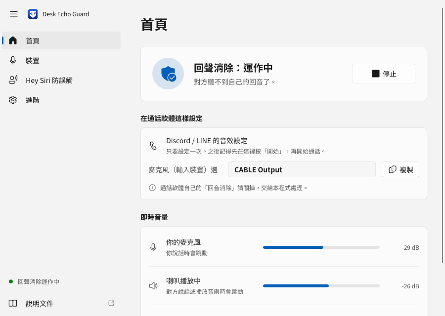
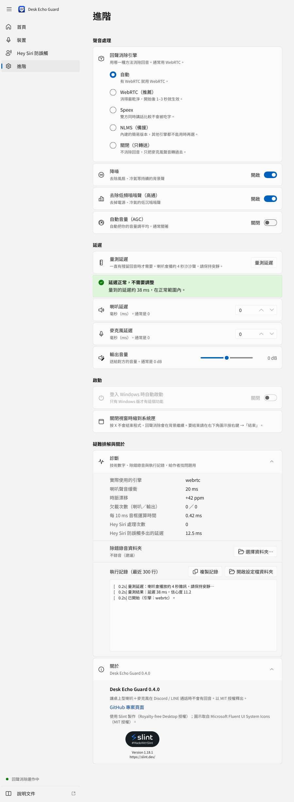

# 進階使用

[← 回 README](../README.md) ・ [5 分鐘上手](getting-started.md) ・ [常見問題](faq.md)

一般使用看 [5 分鐘上手](getting-started.md) 就夠了。這一頁給想自己調整、或想用命令列的人。

## 四個頁面

視窗左邊有四個頁面。每個選項**把滑鼠停在上面**都會跳出說明，這裡只列重點。

- 設定**改了就自動儲存、自動套用**，不用按儲存，也不用先停止；套用時回聲消除會重新開始一下，右下角出現「已套用變更」。
- 設定存在 `%APPDATA%\desk-echo-guard\echoguard.toml`，和舊版（v0.3.1）是同一個檔案。

| 頁面 | 內容 |
|---|---|
| **首頁** | **開始 / 停止**、「在通話軟體這樣設定」（要選哪個裝置，可複製）、三條音量條（你的麥克風 / 喇叭播放中 / 送給對方）、出問題時的提示 |
| **裝置** | 麥克風、喇叭（預設用 Windows 的預設裝置）、VB-Cable 狀態、**整理 VB-Cable…**（[改名與停用](faq.md#vb-cable-改名後叫什麼)）、手動指定虛擬音效線、還原 VB-Cable |
| **Hey Siri 防誤觸** | 啟用、模式、強度、`detect` 模式的模型檔與靈敏度，見 [Hey Siri 防誤觸](siri-guard.md) |
| **進階** | 回聲消除引擎、降噪 / 高通 / 自動音量、延遲（量測延遲、喇叭延遲、麥克風延遲、輸出音量）、登入時自動啟動、診斷（技術數字、除錯錄音資料夾、執行記錄、複製記錄、開啟設定檔資料夾）、關於 |





## 命令列

不開視窗、直接在命令提示字元執行，功能和視窗版一樣，選項和舊版 `python -m echoguard` 相同。

```bat
DeskEchoGuard.exe --list-devices
DeskEchoGuard.exe --mic "USB" --speaker "Realtek" --out "CABLE Input"
DeskEchoGuard.exe --mic "USB" --speaker "Realtek" --siri-guard --siri-mode always
DeskEchoGuard.exe --config echoguard.toml
DeskEchoGuard.exe --calibrate --mic "USB" --speaker "Realtek"
DeskEchoGuard.exe --help
```

- **不加任何選項**（或只加 `--config`）會開視窗；加了其他選項才是命令列模式。
- 按 **Ctrl+C** 停止。
- 它本身是視窗程式，所以命令提示字元可能先顯示提示符號，輸出接在後面印出，這是正常的。
- **裝置名稱**用「部分字串、不分大小寫」比對，例如 `--mic "USB"`。先用 `--list-devices` 看名稱（`*` = Windows 預設裝置）。
  - `--out "CABLE Input"`、`--call-in "CABLE-A Output"` 在 VB-Cable 改名後也找得到。
- 長選項可以只打開頭，只要不會混淆，例如 `--list-dev`。

**狀態輸出**：每 5 秒（`--stats-interval-s`）印一行，包含：

- 麥克風、參考（喇叭）、輸出音量
- 參考緩衝水位、時脈漂移 ppm、欠載次數（`ur=`）
- 輸出緩衝水位與欠載次數
- 每 10 ms 音框的運算時間（`aec ... ms/10ms`）
- 開 Hey Siri 防誤觸時，偵測到的次數
- 麥克風峰值接近滿刻度時，會多印一行警告

### 常用選項

| 選項 | 說明 |
|---|---|
| `--list-devices` | 列出音效裝置後結束 |
| `--list-engines` | 列出可用的回聲消除引擎 |
| `--calibrate` | 播約 4 秒雜訊，量喇叭到麥克風的延遲，印出建議的 `--delay-ms` / `--mic-delay-ms` |
| `--rename-vbcable rename` / `hide` / `restore` | 整理 VB-Cable：改名 / 停用用不到的 / 全部還原。要在**系統管理員**命令提示字元執行（[說明](faq.md#vb-cable-改名後叫什麼)） |
| `--self-test [報告.txt]` | 自我檢測（不需要音效裝置），最後一行應是 `RESULT: PASS`；結束代碼 0 = 通過 |
| `--version` | 顯示版本 |
| `--mic` / `--speaker` | 實體麥克風 / 喇叭（預設：Windows 預設裝置） |
| `--out` / `--call-in` | VB-Cable 端點（預設 `CABLE Input` / `CABLE-A Output`，通常不用改） |
| `--engine` | `auto`（預設，有 WebRTC 就用）/ `webrtc` / `speex` / `nlms` / `off` |
| `--noise-suppression` / `--high-pass` / `--agc` | `on` / `off`（預設：開 / 開 / 關） |
| `--delay-ms` / `--mic-delay-ms` | 延遲補償，見下方[調校](#調校) |
| `--output-gain-db` | 送給對方的音量（dB） |
| `--filter-ms` | Speex / NLMS 濾波器長度（預設 300） |
| `--ref-buffer-ms` / `--out-buffer-ms` | 參考 / 輸出緩衝（預設 20 / 40 ms） |
| `--siri-guard` | 開 Hey Siri 防誤觸 |
| `--siri-mode` | `always`（預設）/ `sibilant` / `detect` |
| `--siri-profile` | `deep-wide`（預設）/ `apple-deep` / `apple-wide` / `formant` |
| `--siri-model` | `detect` 模式用的喚醒詞模型（`.onnx`），可以給多個 |
| `--siri-threshold` | `detect` 模式的門檻（預設 0.5，越高越不敏感） |
| `--debug-wav DIR` | 結束時把 mic / ref / out / call 錄音存到資料夾（最多 10 分鐘） |
| `--duration-s N` | N 秒後自動停止 |

完整選項見 `DeskEchoGuard.exe --help`。

### 設定檔

- `--config 檔案.toml` 讀設定檔，命令列參數會覆蓋設定檔裡的值。
- 鍵名就是命令列長選項名稱，`-` 或 `_` 都可以，例如 `delay_ms = 40`。可以分 `[devices]`、`[aec]`、`[siri]` 等區塊，也可以不分。
- 寫錯鍵名會直接報錯（`unknown key in ...`）。
- 範例：[`echoguard.example.toml`](../echoguard.example.toml)，複製一份來改（檔案開頭的註解還是舊版的 `python -m echoguard` 寫法，換成 `DeskEchoGuard.exe` 即可）。
- **命令列不會自動讀視窗版的設定**。想用同一份設定：

  ```bat
  DeskEchoGuard.exe --config "%APPDATA%\desk-echo-guard\echoguard.toml"
  ```

- 視窗版也可以指定別的設定檔：`DeskEchoGuard.exe --config 檔案.toml`（改了會存回那個檔案）。

### 離線處理錄音

不用音效裝置，直接處理錄好的 wav（任何取樣率，多聲道會混成單聲道）：

```bat
:: 回聲消除：麥克風錄音 + 喇叭（參考）錄音 → 輸出
DeskEchoGuard.exe --sim-mic debug\mic.wav --sim-ref debug\ref.wav --sim-out o.wav --engine speex
:: Hey Siri 防誤觸：通話聲音 → 處理後
DeskEchoGuard.exe --sim-guard-in call.wav --sim-guard-out call_guarded.wav --siri-mode always --siri-profile formant
```

## 調校

| 情況 | 處理 |
|---|---|
| 開頭幾秒還有回聲 | 正常。WebRTC 約 1–3 秒收斂，Speex 約 5–10 秒。 |
| 你們同時講話時，你的聲音被吃掉或斷斷續續 | 引擎改用 **Speex**。雙方同時講話時保留得好很多，代價是頻寬只到約 7 kHz、收斂較慢（數據見[引擎比較](how-it-works.md#引擎比較)）。 |
| 一直有殘留回聲 | 按「量測延遲」（或 `--calibrate`），依結果處理：<br>- WebRTC 會自己估延遲，通常不用設。<br>- Speex / NLMS 若延遲超過濾波器長度（預設 300 ms），用「喇叭延遲」（`--delay-ms`）補。<br>- 若顯示參考訊號「晚到」，用「麥克風延遲」（`--mic-delay-ms`）把麥克風延後。 |
| 喇叭開很大聲或喇叭失真 | 回聲消除只能消掉線性的部分，失真消不掉。調小喇叭音量，或把喇叭移離麥克風。 |
| 麥克風太大聲的警告 | 見[常見問題](faq.md#出現麥克風太大聲的警告)。 |
| 參考緩衝欠載（`ur=` 一直增加） | 加大 `--ref-buffer-ms`，例如 30–40。 |
| 想錄下來分析 | **進階 → 診斷 → 除錯錄音資料夾**（或 `--debug-wav debug`）。停止後可以離線換引擎重跑，見[離線處理錄音](#離線處理錄音)。 |

延遲多少，見[運作原理](how-it-works.md#延遲)。
